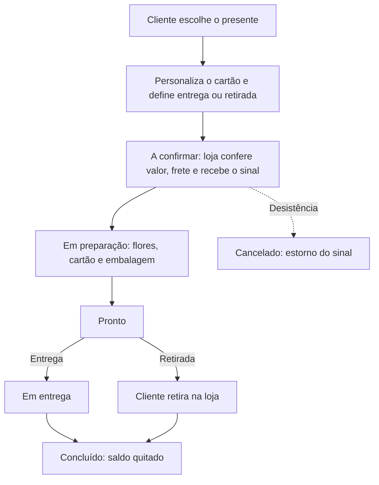

# Floricultura

**Uma loja de flores online com o atendimento da equipe no mesmo lugar.**

Catálogo, personalização do presente e painel de pedidos com recebimentos, preparação e agenda de entregas.

[Demonstração](https://wrkcoronel.github.io/floricultura/) · [Funcionalidades](#funcionalidades) · [Como funciona](#como-funciona) · [Como testar](#como-testar)

**PROTÓTIPO INTERATIVO · Loja online e painel de atendimento**

---

## O que é o projeto

A Floricultura simula a jornada completa de uma floricultura: o cliente escolhe o presente, personaliza o cartão e define entrega ou retirada; a equipe acompanha o pedido no painel, registra recebimentos, confere a preparação e conduz a entrega.

O site funciona no navegador, com layout adaptado para celular e computador. Todos os dados são fictícios e ficam guardados no próprio navegador, o que permite apresentar o fluxo sem servidor nem cadastro.

## Funcionalidades

| Recurso | O que permite fazer |
| --- | --- |
| Loja e personalização | Escolher o presente, escrever o cartão e definir entrega ou retirada |
| Painel de pedidos | Cadastrar, editar, buscar e filtrar pedidos |
| Recebimentos | Registrar sinal, saldo, pagamento completo e estorno (fictícios) |
| Preparação e agenda | Conferir o checklist, o responsável e as etapas de entrega ou retirada |
| Demonstração persistente | Manter os dados no navegador e restaurar os exemplos iniciais |

## Como funciona

O protótipo representa a operação de uma floricultura do pedido à entrega. Cada pedido passa por etapas que o cliente e a equipe acompanham pelo mesmo registro.

| Etapa | Responsável | O que acontece |
| --- | --- | --- |
| A confirmar | Atendimento | Confere o pedido, define o frete e registra o sinal |
| Em preparação | Produção | Monta o arranjo e marca o checklist de flores, cartão e embalagem |
| Pronto | Produção | Libera o pedido para a saída ou para a retirada |
| Em entrega | Entrega | Leva o presente no período escolhido pelo cliente |
| Concluído | Atendimento | Confirma a entrega ou a retirada e recebe o saldo |

## Como testar

1. Abra a [demonstração](https://wrkcoronel.github.io/floricultura/) e faça um pedido com dados fictícios.
2. Em **Painel da loja**, registre um sinal e marque a preparação.
3. Na agenda, conclua a entrega. **Recomeçar demonstração** volta aos exemplos.

Para rodar localmente, sem dependências: `python -m http.server 4178` e abra `http://127.0.0.1:4178/`.

## Limites do protótipo

- Use somente dados fictícios. O painel está aberto para apresentação, sem login.
- Os dados ficam no `localStorage` do navegador utilizado.
- Recebimentos, estornos e a chave Pix são apenas de demonstração. Não há cobrança nem envio de mensagens.
- Uma versão de produção precisaria de autenticação, backend, banco de dados e integração com pagamento.

## Créditos

As fotografias vêm do Unsplash, sob a Licença Unsplash. A origem de cada imagem está em [`CREDITOS.md`](CREDITOS.md).

---

**FLORICULTURA** · Protótipo de loja online e painel de atendimento

